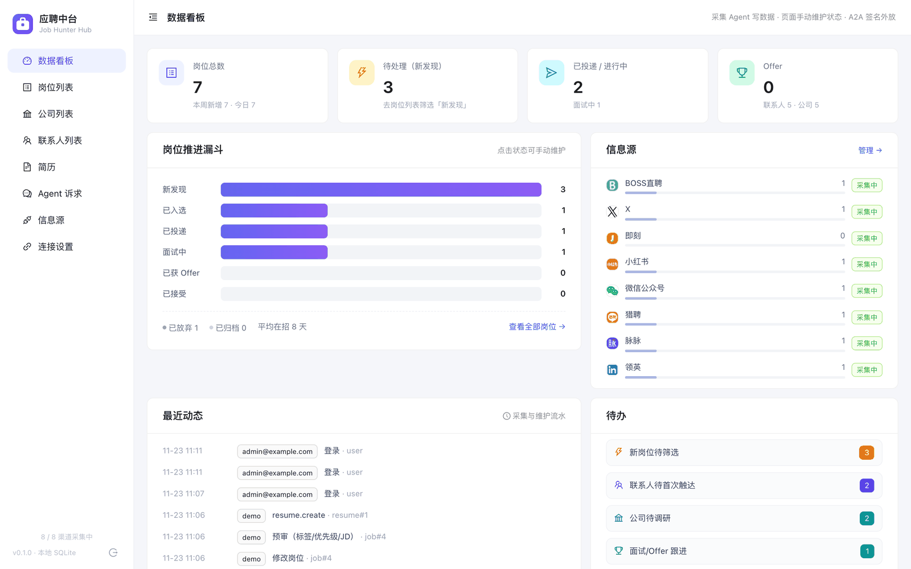
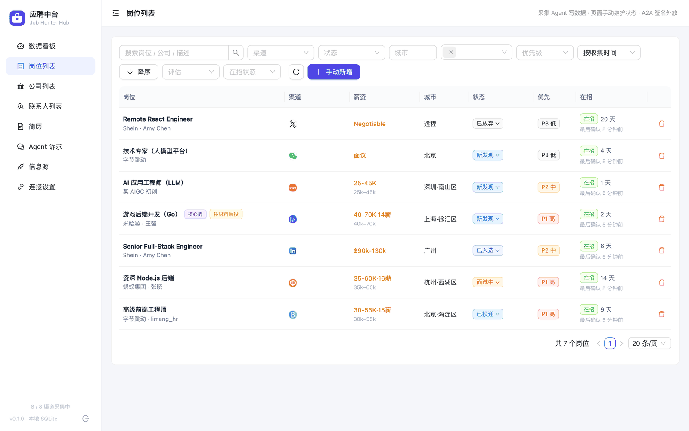
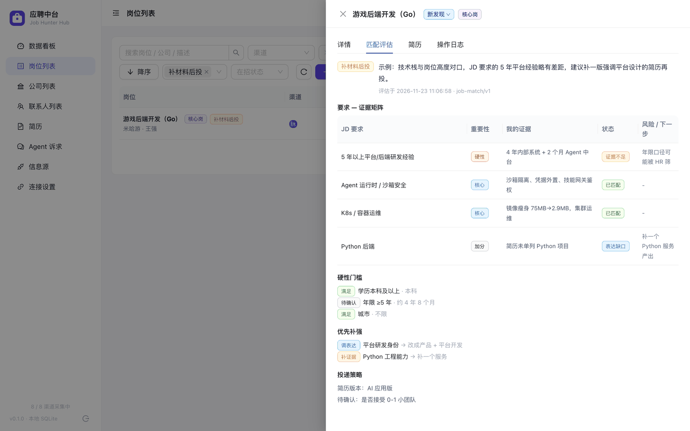
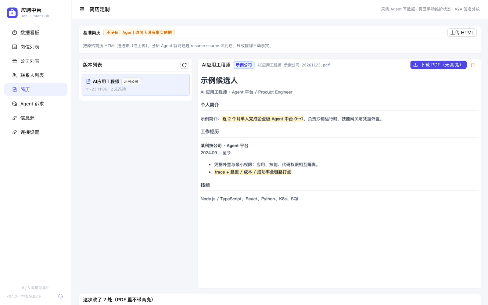
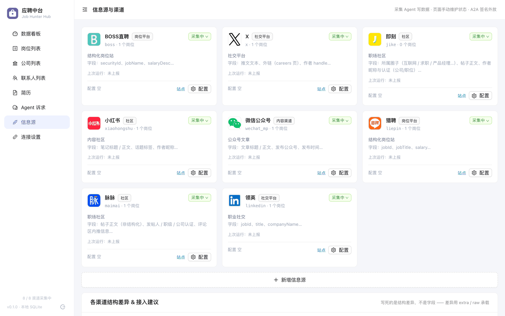
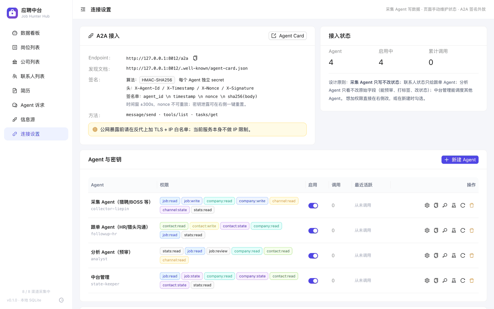
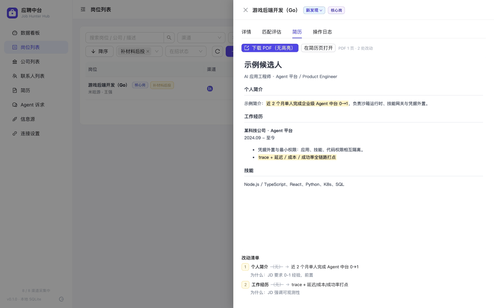

<div align="center">


<h1>应聘中台 · Job Hunter Hub</h1>

<p><b>Agent 去采集，中台来沉淀，你只做决策。</b></p>

<p>
  <a href="LICENSE"></a>
  
  
  
  
</p>

<p>
把猎聘 / BOSS / 领英 / 小红书 / X / 脉脉 / 即刻 / 公众号上散落的招聘信息，<br>
交给你自己的 Agent 采进来；中台负责幂等入库、状态机、JD 预审、简历定制，一路推进到 offer。
</p>

</div>

| | |
|---|---|
| **数据看板** —— 漏斗、渠道来源、待办、采集流水<br> | **岗位列表** —— 状态机一键推进、标签、在招时长、评估结论<br> |
| **JD 匹配评估** —— 按 job-match 口径：结论 + 要求·证据矩阵 + 硬门槛 + 补强建议<br> | **简历定制** —— 针对岗位改写、改动处高亮浏览、下载无高亮的 PDF<br> |
| **信息源** —— 每个渠道独立状态机（人工验证 / 登录失效 / 限流）<br> | **连接设置** —— 按 Agent 发密钥、限权限、配提示词与任务配置<br> |

## 它解决什么问题

- **采集侧不稳定就不要耦合进来**：Agent 只往外发 HTTPS，中台不依赖任何反爬框架；渠道加一行就能接。
- **数据要能沉淀**：`channel + source_job_id` 幂等入库，重复上报只更新；在招时长、疑似下架、已下架由服务端自己算。
- **状态和口径只在一处**：岗位 / 公司 / 联系人 / 渠道四套状态机是唯一真相源，页面点和接口调用走同一套校验。
- **预审交出去**：分析 Agent 按 `job-match` 拆 JD、对证据、给结论，每处判断都留理由进操作日志。
- **能力渐进披露**：Agent 不需要你口头教——复制一段接入说明，它自己调 `agent.capabilities` 问清楚能干什么。

---

## 快速开始

```bash
./dev.sh                      # 后端 :8010 + 前端 :5199（首次自动装依赖）
```

打开 http://localhost:5199 。首次启动只写入 7 个信息源和 4 个默认 Agent，**不塞任何岗位/公司/联系人**（真实数据留给采集 Agent 自己录）。
想先看看界面长什么样，用 `JOBHUB_SEED_DEMO=1 ./dev.sh` 启动，示例数据可在「连接设置 → 维护」一键清空。

生产/自用单端口：

```bash
./serve.sh                    # 构建前端后由后端一起托管，只开 8010
```

## 目录

```
backend/
  main.py       FastAPI：页面接口 + /a2a + 静态托管
  a2a.py        agent card / 签名校验 / 工具注册与权限
  service.py    业务读写（页面和 A2A 共用同一套，避免两套行为）
  state.py      状态机唯一真相源
  db.py         建表 / 默认渠道 / 默认 Agent / 示例数据
  test_smoke.py 自检：python test_smoke.py
docs/screenshots/  README 用的界面截图（示例数据）
frontend/
  src/pages/    Dashboard · Jobs · Companies · Contacts · Resume · Reports · Channels · Settings
  src/channelNotes.js  各渠道字段差异调研笔记
  public/logos/ 官方 logo（本地化，避免外链失效）
mail-worker/    只做发信的 Cloudflare Worker（send_email 绑定，HMAC 校验）
data/recruit.db SQLite 数据文件
data/mail.json  发信配置（600 权限，不进 git）
```

## 数据模型

| 实体 | 关键点 |
|---|---|
| **渠道 channels** | `code` 是 Agent 上报时的唯一标识；可随时新增，后端不硬编码任何渠道 |
| **岗位 jobs** | 核心字段固定列；渠道特有字段进 `extra`，原始响应进 `raw`（永不改写） |
| **公司 companies** | 按去空格小写名唯一；采集岗位时自动建档，无需先建公司 |
| **联系人 contacts** | HR / 猎头 / 内推 / 面试官；与公司、渠道、岗位关联 |
| **流水 activity** | 所有状态变更和采集写入都留痕，注明 `ui` 或 `agent:<id>` |

**渠道差异怎么消化**：核心字段（title / company_name / salary_raw / city / url / source_job_id）
所有人统一；平台特有的东西塞 `extra`（如 BOSS 的 `welfare`、小红书的 `images`）。
平台改版时只改 Agent 侧的字段映射，库里数据不用迁移。

**幂等**：`fingerprint = channel + source_job_id`，没有 source_job_id 时退化为
`channel + hash(title|company|city)`。同一岗位重复上报只更新、不重复入库。

**生命周期（服务端自己算，Agent 不用上报）**：

| 字段 | 含义 |
|---|---|
| `first_seen_at` | 首次被采集到，只写一次 → 在招时长的起点 |
| `last_seen_at` | 每次上报都刷新，内容没变也算「它还在」 |
| `seen_count` | 被采集到几次 |
| `last_change_at` | 内容真正变化的最后一次（只比 title/company/salary/city/description/url 等核心字段，`raw`/`extra` 每抓都可能不同，不参与判定） |
| `presence` | `open` 在招 / `stale` 疑似下架 / `gone` 已下架 |
| `closed_at` | 判定下架的时间 |
| `open_days` | 在招天数 = (closed_at 或 现在) - first_seen_at，接口直接返回 |

下架不靠 Agent 报：服务端隔一阵扫描一次（页面打开时顺手跑，30 分钟最多一次）——
`JOBHUB_STALE_DAYS`（默认 7）天没再被采集到 → 疑似下架；`JOBHUB_GONE_DAYS`（默认 21）天 → 判定已下架并记 `closed_at`。
下架后又重新采集到 → 自动复招（`presence=open`、`closed_at` 清空），同一行继续累加，不会新建。
`job.upsert` 的返回里带 `changed`，Agent 可以据此知道自己这次是新增、更新还是纯重复。

**薪资**：`salary_raw` 保留原文，同时解析出 `salary_min / salary_max / salary_months`，
支持 `30-55K·15薪`、`25-45K`、`面议`、`$90k-130k`。

## 状态机（手动维护 + 外放维护都走同一套校验）

```
岗位 new → shortlisted → applied → interviewing → offer → accepted → archived
              └──────────┴───────────┴────────────┴─→ rejected → archived
公司 new → researching → target → archived / blacklisted
联系人 new → contacted → replied → following → closed
                     └────────→ cold → contacted
渠道 active → need_verify（待人工验证）/ login_expired（登录失效）/ degraded（限流风控）
             / paused（本人暂停）/ disabled（停用）；人工处理完 need_verify、login_expired → active
```

- 页面上：状态列是一个下拉 Tag，只列出「允许的下一步」，点一下即改。
- 接口上：`job.set_state` / `company.set_state` / `contact.set_state` / `channel.update`。
  非法跳转返回 `-32004` 并告诉你可选状态。
- 改状态定义只需动 `backend/state.py`，页面下拉、接口校验、看板漏斗会一起变。

## A2A 接入

发现文档：`GET /.well-known/agent-card.json`（每个技能带 `x-required-scope` 和 `x-params`）
调用入口：`POST /a2a`（JSON-RPC 2.0，支持 `message/send` · `tools/list` · `tasks/get`）

请求体：

```json
{"jsonrpc":"2.0","id":1,"method":"message/send","params":{"message":{"role":"user","parts":[
  {"kind":"data","data":{"tool":"job.upsert","arguments":{"jobs":[
    {"channel":"liepin","source_job_id":"l-1","title":"高级前端工程师","company_name":"某公司",
     "salary_raw":"30-55K·15薪","city":"上海","url":"https://...","extra":{},"raw":{}}]}}}]}}}
```

### 签名（每个 Agent 独立 secret）

请求头：`X-Agent-Id` / `X-Timestamp`（秒） / `X-Nonce` / `X-Signature`

```
canonical = agent_id + "\n" + timestamp + "\n" + nonce + "\n" + sha256_hex(raw_body)
X-Signature = hex(HMAC_SHA256(agent_secret, canonical))
```

- 时间窗 ±300 秒，`nonce` 不可重复（防重放），密钥可在页面一键重置。
- 只支持签名校验，不做 IP 限制等——公网暴露请自行在反代加 TLS + 白名单。

### 权限矩阵（工具 → scope）

| 工具 | scope |
|---|---|
| `job.upsert` / `job.update` / `job.delete` | `job:write` |
| `job.set_state` | `job:state` |
| `contact.upsert` | `contact:write` |
| `contact.set_state` | `contact:state` |
| `channel.get` / `channel.list` | `channel:read` |
| `channel.set_state` / `channel.report` | `channel:state`（采集 Agent 必须给，才能回报人工验证/登录失效） |
| `channel.update` | `channel:write` |
| `job.review`（预审：标签/优先级/匹配度/JD/状态） | `job:review` |
| `job.fit`（JD 匹配评估：结论+证据矩阵+硬门槛+补强） | `job:review` |
| `resume.submit` / `resume.list`（按岗位定制简历） | `job:review` |
| `job.attachment.get`（读附件 base64 做多模态解析） | `job:read` |
| `report.submit` / `report.list`（看自己） | 无需 scope |
| `report.update`（接单/驳回/结单）/ `report.list`（看全部） | `agent:write` |
| `agent.capabilities` / `agent.config.get`（读自己） | 无需 scope（按签名认身份） |
| `agent.config.get`（读别人）/ `agent.config.set` / `agent.list` | `agent:write`（管理 Agent） |
| `company.*` | 同名 scope |
| `*.list` / `*.get` / `stats.dashboard` | `*:read` |

默认预置 4 个 Agent（密钥在「连接设置」里点钥匙查看）：

| Agent | 权限 | 用途 |
|---|---|---|
| `collector-liepin` | job/company 读写 + channel:read | 采集；**没有** contact:state、job:state |
| `followup-hr` | contact 读写与状态 + company:read | 跟进 HR/猎头 |
| `analyst` | 全库只读 | 报表、匹配度分析 |
| `state-keeper` | 只推进状态，不能新增删除 | 你要外放的「状态维护接口」 |

错误码：`-32001` 签名/时间戳/nonce 问题（HTTP 401）、`-32003` 缺权限、
`-32002` 对象不存在、`-32004` 非法状态跳转、`-32602` 参数问题。

## 岗位上报的两种方式

| 方式 | 工具 | 什么时候用 |
|---|---|---|
| 单条 | `job.upsert` / `job.sync_company` 里的 jobs[] | 只看到一两个岗位，或补详情 |
| **整家公司全量** | `job.sync_company` + `complete: true` | 抓完某公司在某渠道的全部在招岗位 → 清单里没有的在招岗位**直接判下架**（`gone_reason=company_sync`） |

`complete: false`（默认取 `true`）时只做 upsert，不会判下架，适合分页抓一半的场景。

**核心岗位的详情页失效**：`job.mark_gone`（`reason: detail_404`）。按 `id`、`fingerprint` 或
`{channel, source_job_id}` 定位，直接判下架并记原因；之后要是又采到了，自动复招。

**附件（JD 截图 / 海报）**：`job.add_attachment`，传 `data_base64` 或公网 `url`（中台自己下载），
支持 png/jpg/webp/gif/pdf，单张 8MB；文件落 `data/uploads/jobs/<id>/`，页面在 `GET /files/...`（需登录）。

- **只保留最新截图**：同一岗位传新图会自动删掉旧的（`JOBHUB_KEEP_IMAGES`，默认 1）；同内容不重复存
- **明确不要的岗位拒收**：状态为 `rejected` / `archived` 时上传直接报错，不占空间
- 「连接设置 → 维护 → 清理放弃岗位附件」可一次性回收已放弃/归档岗位的磁盘

**标签**：岗位和公司都有 `tags`（字符串数组）。采集侧可以带，页面也能改（回车新增）。
岗位列表支持按标签、在招状态过滤。

## 操作日志与「为什么这么改」

岗位 / 公司 / 联系人 的状态变更、附件、预审都写进 `activity`，每条可带一句 **说明（note）**：

- 页面：点状态 Tag → 选目标状态 → 弹窗里可选填说明 → 确认
- Agent：`job.set_state` / `job.review` / `company.set_state` / `contact.set_state` 都支持 `note` 参数
  （预审 Agent 建议必填，日志里就能看到它为什么把岗位标核心 / 改状态）
- 查看：三个详情抽屉都有「操作日志」Tab，按对象 id 过滤；
  日志里显示时间、执行者（`你` / `agent:xxx`）、做了什么、`from → to`、以及那段说明

## JD 匹配评估（job-match 口径）

分析 Agent 用 `job.fit` 把每个岗位的匹配结论写回中台，页面在岗位抽屉的「匹配评估」Tab 里展示：

```
verdict: apply / apply_after_gap / cautious / skip     ← 结论
reason:  一句话结论 + 最关键原因                        ← 列表里直接显示
requirements[]: {req, importance(must|core|plus), evidence, status, risk}
status: matched 已匹配 / phrasing_gap 表达缺口 / insufficient 证据不足 /
        real_gap 真实缺口 / unknown 待确认
hard_gates[]: {item, status(pass|fail|unknown), note}
gaps[]: {type(phrasing|evidence|skill), item, action}
strategy: {resume_version, confirm[]}
```

岗位列表标题下会显示结论标签，支持按「评估」筛选（含「未评估」）；`match_score` 只当排序辅助，
不输出伪精确百分比（沿用 job-match 技能的口径：证据 > 分数）。

## 简历定制（简历 Tab）

分析 Agent 针对具体岗位改写简历，页面 `/resume` 直接浏览，**改动处黄色高亮**；下载的 PDF 是**干净版**（无高亮）。

```
POST /a2a → tool: resume.submit
{ "job_id": 84, "role": "AI应用工程师", "company": "字节跳动",
  "html": "<!doctype html>…（A4 友好，内联 CSS）",
  "changes": [{"where":"个人简介","before":"…","after":"…","why":"JD 要求 0-1 经验"}] }
```

- 改动处用 `<mark data-why="为什么改">…</mark>` 包住 → 浏览版高亮，生成 PDF 时 `strip_marks()` 去掉
- 文件名自动规范为 `<姓名>_岗位方向_公司_YYYYMMDD.pdf`（`JOBHUB_OWNER_NAME` 控制前缀），存 `data/uploads/resumes/`
- PDF 用本机 Chrome 无头模式渲染（`--print-to-pdf`，A4、去页眉页脚）；可用 `JOBHUB_CHROME` 指定浏览器路径
- 页面上能看改动清单（原文 → 现在 → 为什么），也能删除版本
- 岗位抽屉里也有一份：`详情 | 匹配评估 | 简历 | 操作日志`，看岗位时顺手看这版简历



## 信源上报（采集 Agent → 中台）

```json
{
  "code": "liepin",
  "state": "need_verify",            // 可选，等价于 channel.set_state
  "note": "搜索页出现滑块，连续失败 3 次",
  "run": {
    "started_at": "2026-11-21 09:00:00",
    "finished_at": "2026-11-21 09:04:12",
    "scraped": 120, "created": 8, "updated": 3, "duplicates": 109,
    "errors": [{ "url": "https://...", "reason": "verify_required" }]
  },
  "cursor": { "page": 3, "last_keyword": "前端" },
  "next_check_at": "2026-11-21 13:00:00",
  "credentials_expire_at": "2026-12-01 00:00:00",
  "device": "home-pc-01"
}
```

工具：`channel.report`（一次搞定状态+统计+游标）、`channel.set_state`（只改状态）、`channel.get`（先看状态再决定采不采）。
页面会把 `need_verify` / `login_expired` 顶到「待办」，并给一个「我已处理 → 恢复采集中」按钮。

**采集时机与内容由 Agent 自己决定**，中台只提供状态、口径和存储；`paused` / `disabled` 是本人主动停的，Agent 不应自行改回。

## 接入说明（Agent 自描述）

「连接设置 → Agent 与密钥」每行右侧有个复制按钮：**一键复制接入说明**，粘给任何 Agent 即可。
所有 Agent 拿到的是同一份文案，只有 `X-Agent-Id` 和 `secret` 不同 —— 文案里不列具体工具、不写这个 Agent 该干什么，
只说一句：调 `agent.capabilities` 自己查。

```
tool: agent.capabilities
  arguments {}                          → 身份 + 权限 + 可用工具名与一句话
  arguments {"verbose": true}           → 加上每个工具的参数与示例
  arguments {"tool": "channel.report"}  → 单工具的完整说明 + 上报格式
```

无权限的工具只出现在 `denied_tools` 名字里（不披露参数），需要本人开通。
`verbose=true` 时每个工具还带 `returns`（返回体结构）；顶层有 `conventions`（幂等键、生命周期谁算、
只留最新截图、拒收已放弃岗位、错误码怎么读等 11 条通用约定）。
这样加工具、改参数都不用改那段复制文本，Agent 每次自己问自己有什么能力。

## 接入新渠道

1. 「信息源」页 → 新增信息源，填 `code / 名称 / logo`（logo 建议放 `frontend/public/logos/`）。
2. 采集 Agent 用这个 `code` 直接调 `job.upsert` 即可，**不用改后端代码**。
3. 渠道有特殊字段就塞 `extra`，把原始响应塞 `raw`。

## 部署（可选，公网自用）

默认只在本机跑就够用；想让外面（或手机）访问，推荐 **Cloudflare Tunnel**：机器上不用开端口，也不改路由器。

### 1. 登录模板

- 只放行白名单邮箱：`JOBHUB_ALLOWED_EMAILS=you@example.com`
- 发件人：`JOBHUB_MAIL_FROM=noreply@example.com`
- 验证码 6 位 / 10 分钟 / 单码最多试 5 次 / 60 秒内不可重发；登录态是 30 天 HttpOnly Cookie

### 2. 常驻 + 隧道（macOS launchd）

```bash
./deploy/macos-service.sh                        # 中台常驻 127.0.0.1:8010（JOBHUB_LABEL 可改服务名）
cloudflared tunnel login                         # 浏览器授权一次
./deploy/tunnel.sh jobs your-domain.com jobhub   # 建隧道 + 绑 jobs.your-domain.com
```

```bash
launchctl list | grep jobhub                     # 应用 / 隧道两个服务
tail -f data/logs/app.log data/logs/tunnel.err.log
```

没有 Cloudflare 也能跑：`cloudflared tunnel --url http://127.0.0.1:8010` 拿一个临时域名，或用任意反代指向 8010。

### 3. 发信通道

登录验证码需要发信，三种模式（写在 `data/mail.json`，chmod 600，不进 git；同名环境变量优先）：

```json
{ "mode": "worker", "worker_url": "https://mailer.your-domain.com", "worker_secret": "..." }
```

| mode | 说明 |
|---|---|
| `worker` | 本仓库 `mail-worker/` 那个小 Worker，走 Cloudflare `send_email` 绑定，不存 SMTP 密码 |
| `smtp` | 常规 SMTP，需要 `JOBHUB_SMTP_HOST/PORT/USER/PASS` |
| `log` | 不发信，验证码只写服务日志（本机调试用） |

部署 mailer：

```bash
cd mail-worker && npm i && npx wrangler deploy          # 默认给 <name>.<account>.workers.dev
printf '%s' '<secret>' | npx wrangler secret put MAIL_SECRET
# 建议在 wrangler.jsonc 里给 Worker 绑自定义域名（部分网络访问 workers.dev 会失败）
# 然后把 worker_url / worker_secret 写进 data/mail.json
```

### 4. 环境变量一览

| 变量 | 作用 | 默认 |
|---|---|---|
| `RECRUIT_DB` | SQLite 路径 | `data/recruit.db` |
| `JOBHUB_ALLOWED_EMAILS` | 允许登录的邮箱，逗号分隔 | `admin@example.com` |
| `JOBHUB_MAIL_FROM` | 验证码发件人 | `noreply@example.com` |
| `JOBHUB_MAIL_MODE` / `JOBHUB_MAIL_WORKER_URL` / `JOBHUB_MAIL_WORKER_SECRET` | 发信方式 | 读 `data/mail.json` |
| `JOBHUB_SMTP_HOST/PORT/USER/PASS` | SMTP 模式参数 | - |
| `JOBHUB_OWNER_NAME` | 定制简历文件名前缀（`<姓名>_岗位方向_公司_日期.pdf`） | 空 |
| `JOBHUB_CHROME` | 渲染 PDF 用的浏览器 | macOS 的 Google Chrome |
| `JOBHUB_STALE_DAYS` / `JOBHUB_GONE_DAYS` | 岗位多久没再采到算疑似下架 / 已下架 | 7 / 21 |
| `JOBHUB_KEEP_IMAGES` | 每个岗位保留几张截图 | 1 |
| `JOBHUB_SEED_DEMO` | 设为 1 时写入示例数据 | 不开 |

### Agent 的任务提示词与配置

每个 Agent 有两个可编辑字段：

- `prompt` 任务描述（提示词）——人写，Agent 读，用来告诉它"你该干什么、什么情况跳过"
- `config` 任意 JSON——关键词、频控、阈值这类机器可读的旋钮

**谁能读**：Agent 调 `agent.capabilities` 时直接在 `you.prompt` / `you.config` 里拿到；也可以单独调 `agent.config.get`（不带参数就是自己）。

**谁能改**：
- 你本人：页面「连接设置 → Agent 与密钥 → ⚙」。两个都是自由文本框，JSON 存前会校验；提示词有内容时行上会显示 📝 摘要
- 管理 Agent：勾上 `agent:write` 后可以 `agent.list` 看所有 Agent、`agent.config.set` 改任意 Agent 的 `prompt` / `config` / `scopes` / `active` / `remark`。这样就能让一个"调度 Agent"统一调整其他 Agent 的行为，不用你手动改页面

### Agent 诉求单（Agent → 中台）

任何 Agent 都能提：

```json
{"title":"小红书的薪资字段太乱，建议统一成 K 区间","kind":"data_quality",
 "severity":"high","target":"channel:xiaohongshu",
 "content":"三种写法导致 salary_min/max 为空的有 40%，建议 upsert 前归一"}
```

- 工具：`report.submit` → 生成一张 `open` 状态的单子；`report.list` 看自己/全部（看全部需 `agent:write`）
- 处理：页面「Agent 诉求」或 `report.update`（`agent:write`），状态 `open → accepted/rejected/done`，可写 `response` 回给提交方
- 中台管理 Agent（有 `agent:write`）就是靠这套 + `agent.config.set` 去"调度"其他 Agent 的行为

**Agent 侧注意**：公网入口在 Cloudflare 后面，`Python-urllib` 默认 UA 会被以 1010 拦掉
（requests / httpx / node / go / 自定义 UA 都正常）。HTTP 客户端请显式设一个 UA。


## 已知取舍

- UI 用 HTTP Basic 口令（浏览器原生弹窗），没有独立登录页：够用，想换成表单登录再加。
- A2A 同步返回，不做流式与 push notification（`agent-card` 里已声明）。
- SQLite 单机，够用到几十万岗位；真需要并发再换 Postgres（`service.py` 是唯一要改的地方）。
- `ping`/日志/监控都没做，本地工具不需要；要上云再加。

## License

MIT，见 [LICENSE](LICENSE)。
